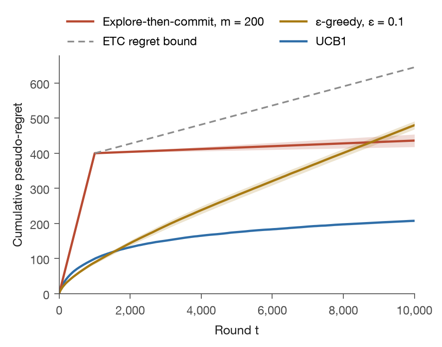
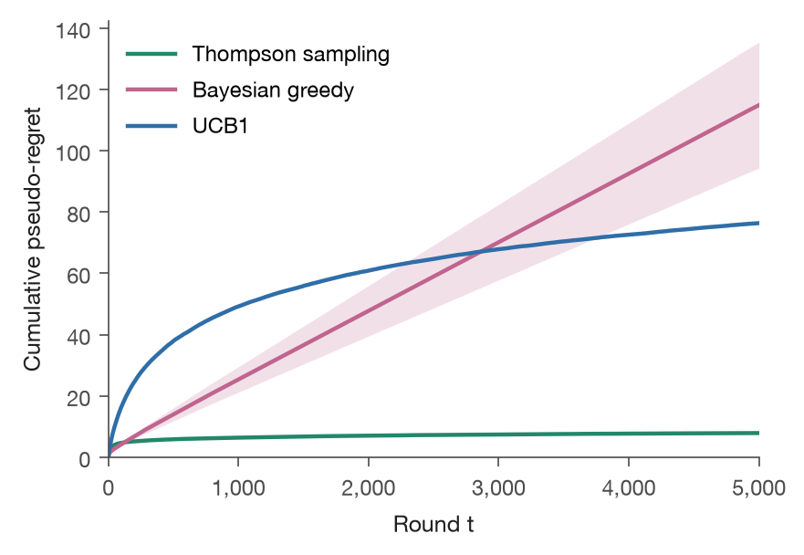
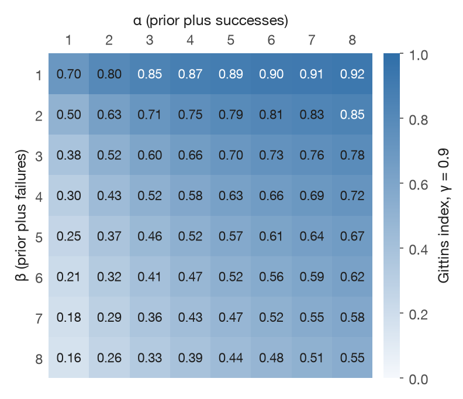
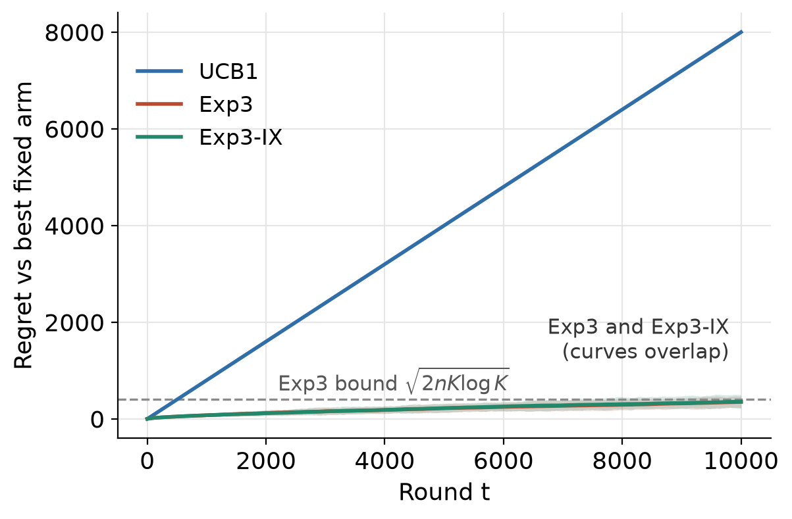
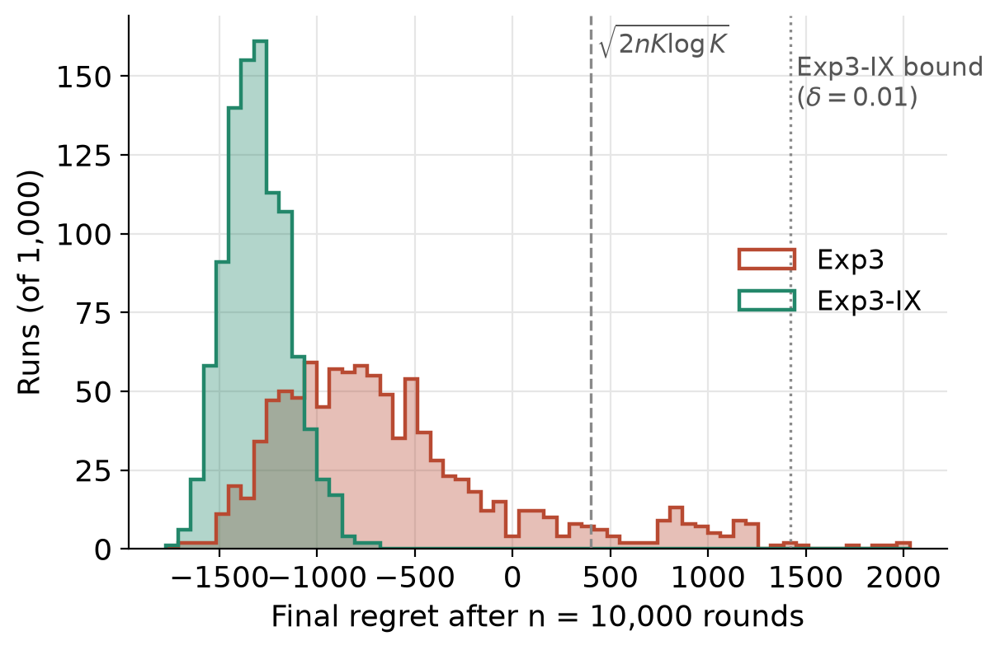
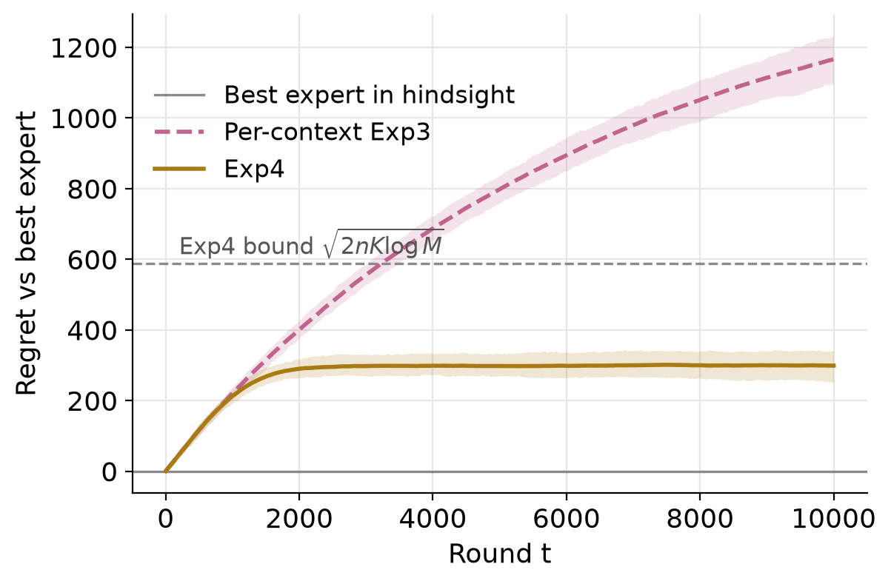
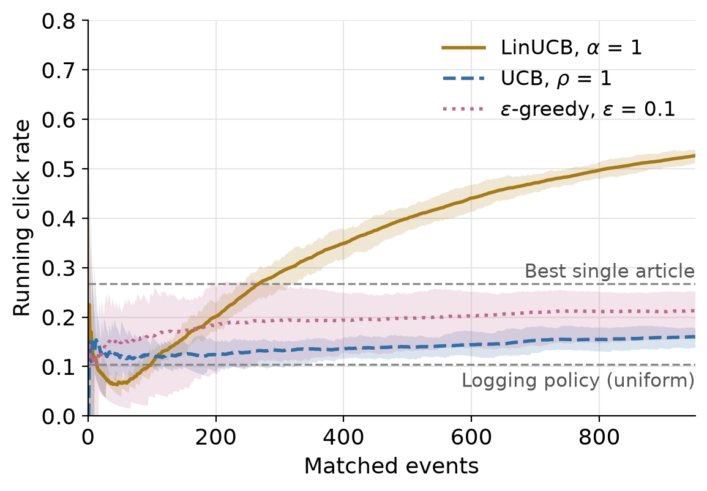
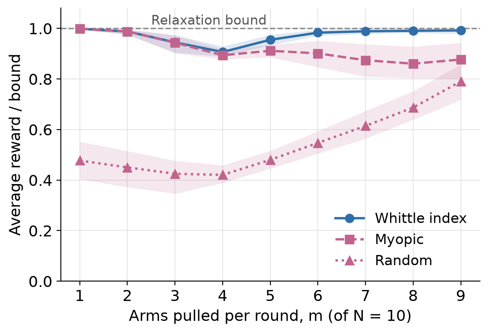
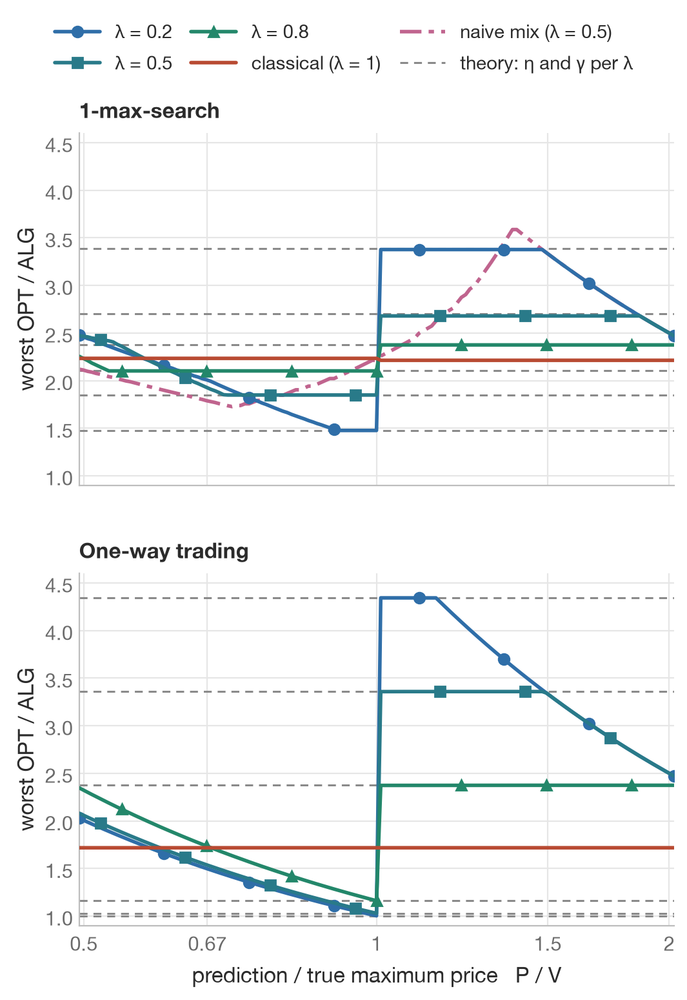
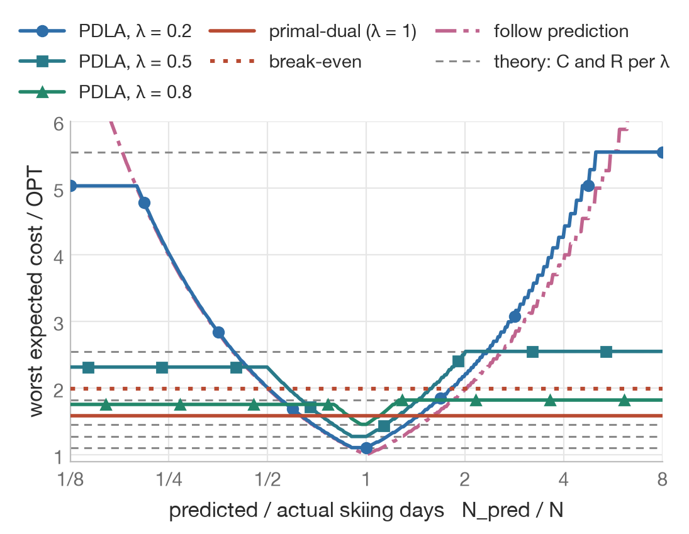

# Multi-armed bandits and online algorithms

Undergraduate research at the University of Alberta, with Amii and SODALab, from 2022 to 2024 on sequential decision-making under uncertainty. It covers multi-armed bandits in the stochastic, Bayesian, adversarial, contextual and restless settings, and online algorithms that use machine-learned predictions.

## About this code

The research code from 2022 to 2024 lived on a computer that no longer exists. In October 2026 I rebuilt it from the slides and the report in this repo, working with Claude as a coding assistant. The rebuild is the `mab/` and `online/` packages with their experiments and tests. The scripts in `algorithms/` and `project/` are the originals that survived from 2023.

Every algorithm follows the derivation in [`Final Report.pdf`](Final%20Report.pdf), the decks in [`slides/`](slides) and [`online_learning/`](online_learning), or the paper they cite. The tests check each one against its proven guarantee. The blog post [Multi-Armed Bandits: Foundations](https://henryvu.blog/series/bandits/part1.html) explains the bandit setting and the upper confidence bound (UCB) algorithm in more depth.

## Results

Every experiment is seeded and reruns to the same numbers.

### Stochastic arms

Five Gaussian arms with means 1.0 to 0.2, 10,000 rounds, 200 seeds. UCB1 ends with regret 207.5. Explore-then-commit (ETC) with 200 pulls per arm ends at 436.0, under its bound of 644.8, and 400 of that is the cost of exploring. ε-greedy with ε = 0.1 never stops exploring, so its regret grows linearly to 479.9.



### Bayesian bandits and the Gittins index

On three Bernoulli arms (0.9, 0.5 and 0.2) over 5,000 rounds, Thompson sampling ends with regret 7.9 against 76.4 for UCB1. Bayesian greedy averages 114.9 because some runs lock onto the 0.5 arm and never leave. The Gittins index is computed by calibration with the report's dynamic program, and it matches R. Weber's published table for γ = 0.9 in all 64 cells (Beta(1, 1) gives 0.7029).

<p>


</p>

### Adversarial bandits

Against an adversary that pays only the arm the learner is least likely to pull, the deterministic UCB1 earns nothing and its regret grows to 8,000 over 10,000 rounds. Exp3 and Exp3-IX stay under Exp3's bound of √(2nK log K) ≈ 401. On a table whose best arm switches, 8.8% of Exp3 runs end above that bound and no Exp3-IX run does, because implicit exploration caps how much one unlucky round can cost an arm.

<p>


</p>

### Contextual bandits

With 32 experts of which one is informative, Exp4 ends with regret 299 against the best expert, a quarter of per-context Exp3's 1,167. On the logged news-recommendation data, scored with the replay method of Li et al. (2011) and every parameter fixed in advance, LinUCB reaches a click rate of 0.533. The best single article gets 0.268.

<p>


</p>

### Restless bandits and the Whittle index

Ten two-state arms that tire when worked and recover when rested, with m of them pulled each round. When m is 6 to 9, the Whittle index policy reaches 98.3% to 99.2% of the relaxation's upper bound and the myopic policy 86% to 90%.



### Online algorithms with predictions

For one-way trading with a price range ratio of 5 and trust parameter λ = 0.5, the Pareto-optimal algorithm of Sun et al. (2021) gets within 3% of the best price in hindsight with a perfect prediction, where the classical algorithm's ratio is 1.72, and never exceeds its robustness of 3.36. The primal-dual ski rental algorithm of Bamas et al. (2020) at λ = 0.5 costs 1.276 times the optimum with a perfect prediction and at most 2.551 times otherwise, both exactly its proven bounds. The knapsack threshold rule reaches its bound of 1 + ln θ, and water-filling matching reaches 1 − 1/e on the hard upper-triangular instance, where greedy falls to one half.

<p>


</p>

## Layout

| Path | What it holds |
|---|---|
| `mab/stochastic.py` | Gaussian and Bernoulli arms; explore-then-commit, UCB1 and ε-greedy; the ETC regret bound |
| `mab/bayesian.py` | Thompson sampling, Bayesian greedy, and the Gittins index by calibration |
| `mab/adversarial.py` | Oblivious and adaptive adversaries; Hedge, Exp3 and Exp3-IX |
| `mab/contextual.py` | Per-context Exp3, Exp4 with expert advice, LinUCB and replay evaluation |
| `mab/restless.py` | Two-state restless arms, the Whittle index, an indexability check and index policies |
| `online/conversion.py` | 1-max-search and one-way trading, classical and learning-augmented (Sun et al. 2021) |
| `online/ski_rental.py` | Break-even, primal-dual, and learning-augmented primal-dual ski rental (Bamas et al. 2020) |
| `online/knapsack.py` | Online fractional knapsack with the Zhou, Chakrabarty and Lukose threshold |
| `online/matching.py` | Online fractional bipartite matching by water-filling, against greedy |
| `experiments/` | One script per figure in `figures/` |
| `tests/` | Checks each algorithm against its guarantee |
| `algorithms/`, `project/`, `visualization/` | The 2023 scripts, the LinUCB notebook and their figures |
| `slides/`, `online_learning/`, `Final Report.pdf` | The research decks and notes the rebuild follows |

## Running the code

```bash
pip install -r requirements.txt
python -m pytest -q
python experiments/stochastic_regret.py
```

Each script in `experiments/` writes its figures to `figures/`. The Gittins and restless experiments take one to two minutes; the rest take seconds.

## References

- Tor Lattimore and Csaba Szepesvári, *Bandit Algorithms*, Cambridge University Press, 2020. The report and most of the bandit code follow this book.
- Peter Auer, Nicolò Cesa-Bianchi and Paul Fischer, "Finite-time analysis of the multiarmed bandit problem," *Machine Learning*, 2002.
- Peter Auer, Nicolò Cesa-Bianchi, Yoav Freund and Robert E. Schapire, "The nonstochastic multiarmed bandit problem," *SIAM Journal on Computing*, 2002.
- Gergely Neu, "Explore no more: Improved high-probability regret bounds for non-stochastic bandits," NeurIPS, 2015. Source of Exp3-IX.
- J. C. Gittins, "Bandit processes and dynamic allocation indices," *Journal of the Royal Statistical Society B*, 1979.
- P. Whittle, "Restless bandits: activity allocation in a changing world," *Journal of Applied Probability*, 1988.
- Lihong Li, Wei Chu, John Langford and Robert E. Schapire, "A contextual-bandit approach to personalized news article recommendation," WWW, 2010, [arXiv:1003.0146](https://arxiv.org/abs/1003.0146).
- Lihong Li, Wei Chu, John Langford and Xuanhui Wang, "Unbiased offline evaluation of contextual-bandit-based news article recommendation algorithms," WSDM, 2011, [arXiv:1003.5956](https://arxiv.org/abs/1003.5956).
- Bo Sun, Russell Lee, Mohammad Hajiesmaili, Adam Wierman and Danny H. K. Tsang, "Pareto-optimal learning-augmented algorithms for online conversion problems," NeurIPS, 2021, [arXiv:2109.01556](https://arxiv.org/abs/2109.01556).
- Étienne Bamas, Andreas Maggiori and Ola Svensson, "The primal-dual method for learning augmented algorithms," NeurIPS, 2020, [arXiv:2010.11632](https://arxiv.org/abs/2010.11632).
- Yunhong Zhou, Deeparnab Chakrabarty and Rajan Lukose, "Budget constrained bidding in keyword auctions and online knapsack problems," WINE, 2008.
- Niv Buchbinder, Kamal Jain and Joseph Naor, "Online primal-dual algorithms for maximizing ad-auctions revenue," ESA, 2007.
